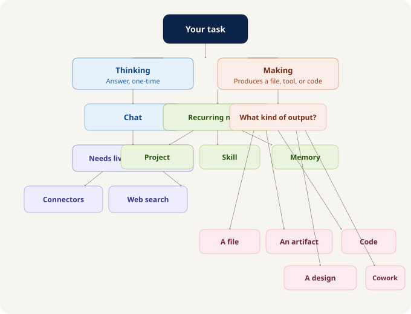
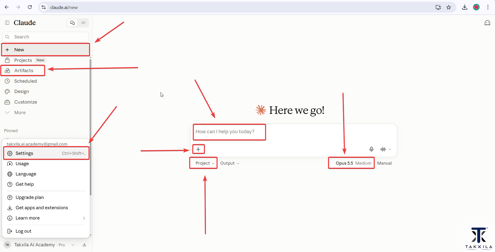
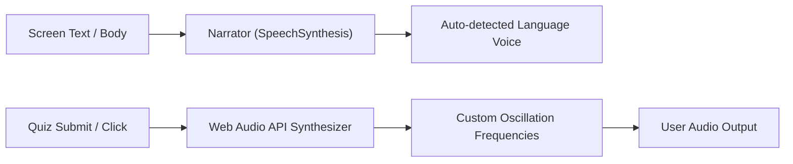

<div align="center">


# 🏛️ TAKXILA AI ACADEMY
### *Claude Deep Dive — Master Claude. Build With Claude. Work With Claude.*

[](https://react.dev/)
[](https://www.typescriptlang.org/)
[](https://vitejs.dev/)
[](https://mui.com/)
[](#-scorm-12-lms-export--integration)
[](#-30-languages--live-translation-engine)
[](#-audio--narration-engine)

<p align="center">
  <b>12 In-Depth Modules</b> • <b>222 Course Screens</b> • <b>Interactive Knowledge Checks</b> • <b>SCORM 1.2 LMS Ready</b><br/>
  <b>30-Language Live Translation</b> • <b>Browser TTS Audio Narration</b> • <b>Takxila FX & Theme System</b> • <b>Zero Backend Needed</b>
</p>


---

</div>

> [!TIP]
> **Blazing fast performance**: zero-lag slide transitions, reactive state management via `useSyncExternalStore`, fluid typography with *Plus Jakarta Sans* and *JetBrains Mono*, and hardware-accelerated animations (meteors, spotlights, 3D tilt cards, and glowing borders).

> [!NOTE]
> **Works with no backend out of the box.** All progress, quiz scores, and settings persist to browser `localStorage` when running standalone or sync to standard SCORM 1.2 `cmi.suspend_data` when uploaded to any LMS (Moodle, Blackboard, Canvas, CornerStone, etc.).

> [!IMPORTANT]
> **SCORM Dual-Mode Build:** When deploying to an LMS, run `npm run scorm`. This switches Vite's base path to relative (`./`), activates `HashRouter`, and automatically updates `dist/imsmanifest.xml` with dynamic resource paths.

---

## 📑 Table of Contents

- [🆕 Course Overview](#-course-overview)
- [📸 Screenshots & Visual Tour](#-screenshots--visual-tour)
- [✨ Feature Matrix](#-feature-matrix)
- [⚡ Quick Start](#-quick-start)
- [⚙️ Configuration & Content Editing (`course.json`)](#️-configuration--content-editing-coursejson)
- [🧠 Core Modules (1 to 12 Breakdown)](#-core-modules-1-to-12-breakdown)
- [🧩 Interactive Screen Types & Knowledge Checks](#-interactive-screen-types--knowledge-checks)
- [🌐 30 Languages & Live Translation Engine](#-30-languages--live-translation-engine)
- [🔊 Audio & Narration Engine](#-audio--narration-engine)
- [🏫 SCORM 1.2 LMS Export & Integration](#-scorm-12-lms-export--integration)
- [🏗️ State Architecture & Learner Store](#️-state-architecture--learner-store)
- [💾 Storage & Progress Persistence](#-storage--progress-persistence)
- [📁 File Management: Every Folder Explained](#-file-management-every-folder-explained)
- [✍️ Common Tasks (How do I…?)](#️-common-tasks-how-do-i)
- [🎨 Design System & Takxila FX](#-design-system--takxila-fx)
- [🚀 Production Build & Deployment](#-production-build--deployment)
- [🧯 Troubleshooting](#-troubleshooting)

---

## 🆕 Course Overview

**Claude Deep Dive** is a masterclass learning application designed by **Takxila AI Academy**. Rather than treating Claude as a generic conversational chatbot, this course teaches learners to operate Claude as a complete, multi-surface work system:

* **8 Claude Surfaces:** Learn when and how to select Chat, Connectors, Projects, Skills, Artifacts, Claude Code, Cowork, and Claude Design.
* **Persona-Driven Case Studies:** Walk alongside three realistic professionals (Ritika, Karan, and Takshika) solving research, business ops, and curriculum design challenges.
* **Hands-On Deliverables:** Build real tools, reusable system prompts, dynamic artifacts, API connectors, and automated workflows.
* **Self-Paced Interactive Engine:** Interactive checks (MCQs, multi-select, fill-in-the-blank, sequence reordering), sound feedback, XP scoring, and module completion celebrations.

| Metric | Detail |
| :--- | :--- |
| **Modules** | **12 comprehensive modules** covering foundations to autonomous agents |
| **Lesson Screens** | **222 total screens** (lessons, tool intros, practice tasks, quizzes, summaries) |
| **Interactive Activities** | Knowledge checks gating progression until mastered |
| **Estimated Duration** | **~9 to 11 hours** of hands-on, practical learning |
| **Languages Supported** | **30 languages** with dual-provider live translation fallback |
| **Audio** | In-browser speech synthesis (TTS) + synthesized Web Audio API sound effects |
| **LMS Compatibility** | **SCORM 1.2** and **SCORM 2004** compliant with automatic manifest generation |

---

## 📸 Screenshots & Visual Tour

<table>
  <tr>
    <td width="50%">
      <b>Course Banner & Surface Selector</b><br/>
      
    </td>
    <td width="50%">
      <b>Claude Surface Architecture Map</b><br/>
      
    </td>
  </tr>
  <tr>
    <td>
      <b>Module 1: The Claude Interface & Navigation</b><br/>
      
    </td>
    <td>
      <b>Module 1: The 4-Question Surface Selector</b><br/>
      
    </td>
  </tr>
  <tr>
    <td>
      <b>Module 2: Bringing Real Work In & Connectors</b><br/>
      
    </td>
    <td>
      <b>Module 3: Thinking, Researching & Verifying</b><br/>
      
    </td>
  </tr>
  <tr>
    <td>
      <b>Module 6: Building Interactive Tools & Artifacts</b><br/>
      
    </td>
    <td>
      <b>Module 7: Claude as a Coding Partner</b><br/>
      
    </td>
  </tr>
</table>

> Lesson screenshots reside in [`public/images/`](public/images/). If images appear as fallback placeholders after cloning, run `git lfs pull` (see [README-IMAGES.md](README-IMAGES.md)).

---

## ✨ Feature Matrix

| Feature | Implementation | Source Location |
| :--- | :--- | :--- |
| **Course Player** | Responsive lesson reader, sidebar drawer, header controls, step navigation | [`src/pages/Player.tsx`](src/pages/Player.tsx) |
| **Landing Page** | Hero section, dynamic metrics, module cards, 3D tilt effects, lamp glow | [`src/pages/Landing.tsx`](src/pages/Landing.tsx) |
| **Screen Renderer** | Dynamic renderer for 12 distinct lesson and assessment screen types | [`src/components/screens/`](src/components/screens/) |
| **Interactive Checks** | MCQ, Multi-Select, Blank Fill, and Drag/Tap Reordering | [`src/components/screens/Quizzes.tsx`](src/components/screens/Quizzes.tsx) |
| **Audio Narration** | Browser Text-to-Speech (TTS) engine with play/pause and keep-alive | [`src/engine/audio.ts`](src/engine/audio.ts) |
| **Sound FX** | Web Audio API oscillator synthesis (correct/wrong chimes, module bells) | [`src/engine/audio.ts`](src/engine/audio.ts) |
| **30-Language i18n** | Live translation with brand/product keyword protection & prompt shielding | [`src/engine/i18n.ts`](src/engine/i18n.ts) |
| **SCORM 1.2 Wrapper** | LMS communication with automatic `localStorage` shim fallback | [`src/engine/scorm.ts`](src/engine/scorm.ts) |
| **Learner Store** | State machine for progress tracking, attempt counters, and XP calculation | [`src/engine/store.ts`](src/engine/store.ts) |
| **Manifest Generator** | Node.js script walking `dist/` to auto-populate `imsmanifest.xml` resources | [`scripts/scorm-manifest.mjs`](scripts/scorm-manifest.mjs) |
| **LFS Image Checker** | Pre-build/pre-dev audit detecting text pointer stubs vs real images | [`scripts/check-images.mjs`](scripts/check-images.mjs) |
| **Theme System** | Dark Navy (`#0A1022`) and Light Lavender (`#EEF1FB`) with iframe postMessage sync | [`src/theme/theme.ts`](src/theme/theme.ts), [`src/context/ThemeModeContext.tsx`](src/context/ThemeModeContext.tsx) |

---

## ⚡ Quick Start

### Prerequisites
* **Node.js**: v18.0.0 or higher (v20+ recommended)
* **npm**: v9.0.0 or higher

```bash
# 1. Clone repository and install dependencies
npm install

# 2. Start local development server (http://localhost:5173)
npm run dev

# 3. Type check TypeScript files
npm run typecheck

# 4. Standard production web build (output in dist/)
npm run build

# 5. Build for SCORM LMS (creates relative paths & updates imsmanifest.xml)
npm run scorm
```

> [!TIP]
> **Check Images:** Run `npm run check:images` anytime to verify whether lesson screenshots in `public/images/` are fully resolved or Git LFS pointer stubs.

---

## ⚙️ Configuration & Content Editing (`course.json`)

The entire curriculum is **data-driven**, residing in [`src/data/course.json`](src/data/course.json). You can modify course metadata, add lessons, adjust quiz questions, or embed custom video links without touching React components.

### 1. Course Metadata Structure
```json
{
  "course": {
    "id": "TAKXILA-CLAUDEDEEP-01",
    "title": "Claude Deep Dive",
    "subtitle": "Master Claude. Build With Claude. Work With Claude.",
    "description": "A hands-on, self-paced course...",
    "whoFor": "Professionals, freelancers, students, and business owners...",
    "duration": "~9 to 11 hours",
    "moduleCount": 12,
    "brand": "TAKXILA",
    "certificateUrl": "https://your-lms.example.com/certificate"
  }
}
```

### 2. Module & Screen Structure
Every screen inside `modules[].screens` defines its type and content properties:

```json
{
  "id": "m01-s04",
  "type": "text",
  "visuals": 1,
  "heading": "The Surface Selector",
  "body": [
    "Four questions, asked in order, before you touch anything:",
    {
      "list": [
        { "label": "Q1: Is this a one-off query or a system?", "text": "If it's one-off, use Chat..." },
        { "label": "Q2: Does it need external files?", "text": "Use Projects or Connectors..." }
      ]
    }
  ],
  "outputImage": "assets/images/claude-deep-dive-takxila-ai.png"
}
```

### 3. Media Mapping (`src/data/courseData.ts`)
* **Images:** Screens with `"visuals": 1` automatically look for `public/images/<screenId>.png`.
* **Explicit Images:** Set `"outputImage": "assets/images/filename.png"` or `"outputImages": [...]`.
* **Videos:** Set `"outputVideo": "https://www.youtube.com/watch?v=..."` or `"outputVideo": "videos/m02-s04.mp4"`. YouTube links are parsed into privacy-enhanced `youtube-nocookie.com` embeds.

---

## 🧠 Core Modules (1 to 12 Breakdown)

| # | Module Title | Est. Time | Screens | Core Competency |
| :---: | :--- | :---: | :---: | :--- |
| **01** | **Choosing Your Claude Surface** | 40 min | 18 | The 4-Question Surface Selector; Chat vs Projects vs Artifacts vs Claude Code. |
| **02** | **Bringing Real Work In** | 55 min | 19 | Connectors (Google Drive, GitHub, Figma), file uploads, context windows, and source hygiene. |
| **03** | **Thinking, Researching, Verifying** | 55 min | 20 | Extended thinking mode, web search verification, hallucination checks, and citations. |
| **04** | **Turning Work into Deliverables** | 55 min | 19 | Structured outputs, markdown, executive briefs, slide outlines, and tone calibration. |
| **05** | **Personalizing Claude** | 60 min | 18 | Custom instructions, Project Knowledge, style guides, memory management, and reusable templates. |
| **06** | **Building Interactive Tools** | 60 min | 19 | Claude Artifacts: generating React dashboards, SVG diagrams, calculators, and HTML prototypes. |
| **07** | **Claude as a Coding Partner** | 65 min | 20 | Pair programming, debugging, refactoring, writing unit tests, and terminal-based Claude Code. |
| **08** | **Delegating Work** | 60 min | 18 | Multi-agent handoffs, subagent patterns, verification loops, and quality control frameworks. |
| **09** | **Claude as a Design Partner** | 60 min | 20 | UI/UX critiquing, color palette evaluation, wireframing, and design-to-code translation. |
| **10** | **Designing Workflows** | 60 min | 20 | Multi-step recurring pipelines, n8n/Zapier integration, prompt chaining, and standard operating procedures (SOPs). |
| **11** | **Claude for Small Business** | 55 min | 17 | Customer support macros, competitive analysis, proposal drafting, and operational cost savings. |
| **12** | **Your Claude Mastery Recap** | 40 min | 14 | Final capstone synthesis, personal operating manual, certificate eligibility, and next steps. |

---

## 🧩 Interactive Screen Types & Knowledge Checks

The course player includes 12 specialized screen types implemented in [`src/components/screens/`](src/components/screens/):

| Screen Type | Purpose | UI & Interaction |
| :--- | :--- | :--- |
| `module_intro` | Module overview | Banner hero, estimated time badge, and key learning outcomes checklist. |
| `text` | Core pedagogical lessons | Structured paragraphs, bold terminology, highlight callouts, and bullet lists. |
| `tool_intro` | Tool tours & interface maps | Step-by-step UI breakdown with screenshot references. |
| `prompt_and_output` | Prompt engineering examples | Copyable prompt card + expected Claude response output. |
| `practice_task` | Hands-on exercises | Real-world problem prompt, step instructions, and expandable hint/solution. |
| `key_takeaways` | Module recap | High-impact summary cards highlighting essential rules of thumb. |
| `mcq` | Single-choice quiz | Radio options with immediate feedback and explanation. |
| `multi_select` | Multiple-choice quiz | Checkbox options requiring all correct answers to unlock progression. |
| `multi_fill_blank` | Fill-in-the-blank exercise | Dropdown blank selectors within a sentence or code snippet. |
| `reorder` | Sequential ordering check | Interactive tap/drag reordering of workflow steps with verification. |
| `module_complete` | Module celebratory milestone | Confetti burst, completed badge, and next module launcher. |
| `course_complete` | Final graduation screen | Course completion statistics, XP score, and certificate download link. |

---

## 🌐 30 Languages & Live Translation Engine

The course engine incorporates a live translation system supporting **30 global languages** directly in the browser via [`src/engine/i18n.ts`](src/engine/i18n.ts).

### Supported Languages
| Code | Language | Native Name | Code | Language | Native Name |
| :--- | :--- | :--- | :--- | :--- | :--- |
| `en` | English | English | `ar` | Arabic | العربية |
| `hi` | Hindi | हिन्दी | `zh-CN`| Chinese (Simp.) | 中文 |
| `mr` | Marathi | मराठी | `ja` | Japanese | 日本語 |
| `te` | Telugu | తెలుగు | `ko` | Korean | 한국어 |
| `ta` | Tamil | தமிழ் | `ru` | Russian | Русский |
| `gu` | Gujarati | ગુજરાતી | `it` | Italian | Italiano |
| `kn` | Kannada | ಕನ್ನಡ | `nl` | Dutch | Nederlands |
| `ml` | Malayalam | മലയാളം | `pl` | Polish | Polski |
| `pa` | Punjabi | ਪੰਜਾਬੀ | `tr` | Turkish | Türkçe |
| `bn` | Bengali | বাংলা | `vi` | Vietnamese | Tiếng Việt |
| `ur` | Urdu | اردو | `th` | Thai | ไทย |
| `es` | Spanish | Español | `id` | Indonesian | Bahasa Indonesia |
| `fr` | French | Français | `ms` | Malay | Bahasa Melayu |
| `de` | German | Deutsch | `fil`| Filipino | Filipino |
| `pt` | Portuguese | Português | `sw` | Swahili | Kiswahili |

### How It Works:
1. **Brand & Prompt Protection:** High-value terms (`Claude`, `ChatGPT`, `Canva`, `Takxila`, `Jira`, etc.) and system prompts designed to be pasted into Claude are masked with tokens (`__PROTECT0__`) so translation engines never mangle technical terms.
2. **Dual-Provider Resilience:** Translates primarily through Google's translation API; if blocked, it seamlessly falls back to MyMemory API.
3. **In-Memory Caching:** Translated screens and modules are cached in memory so navigating back and forth is instantaneous.
4. **Persistent Choice:** Learner language preference is saved to `takxila_lang_pref__TAKXILA-CLAUDEDEEP-01` in `localStorage`.

---

## 🔊 Audio & Narration Engine

Located in [`src/engine/audio.ts`](src/engine/audio.ts), the audio engine provides multi-modal learning without requiring hundreds of megabytes of recorded MP3 files:



* **Text-to-Speech (TTS):** Extracts heading, body, prompt, and question content, speaking through the browser's native `window.speechSynthesis`.
* **Automatic Voice Matching:** Matches voice locale to the currently active language (e.g. Hindi voice for `hi`, French voice for `fr`).
* **Synthesized Audio Cues:** Uses the browser `AudioContext` and oscillator nodes to generate crisp micro-interactions:
  - *Correct chime*: dual ascending sine wave tones (440Hz → 880Hz).
  - *Incorrect cue*: gentle low-frequency square wave drop.
  - *Module completion*: triumphant multi-tone chord.
* **Persistent Mute Toggle:** One-click global mute control preserved in `localStorage`.

---

## 🏫 SCORM 1.2 LMS Export & Integration

The course is built to run effortlessly inside enterprise LMS environments.

### 1. LMS Communication Architecture
The SCORM wrapper in [`src/engine/scorm.ts`](src/engine/scorm.ts) searches up to 10 parent window frames (and `window.opener`) for the standard `API` object:
* **Inside an LMS:** Calls standard CMI methods:
  - `LMSInitialize("")`
  - `LMSSetValue("cmi.core.lesson_location", screenId)`
  - `LMSSetValue("cmi.suspend_data", packedState)`
  - `LMSSetValue("cmi.core.lesson_status", "completed")`
  - `LMSCommit("")`
  - `LMSFinish("")`
* **Outside an LMS:** Automatically switches to an internal **localStorage shim** (`takxila_scorm_shim_v1__...`). The learner experience remains identical.

### 2. Packaging for LMS Deployment
Run the automated packaging command:
```bash
npm run scorm
```
This script executes two steps:
1. Builds Vite with `--mode scorm`: sets asset base URL to `./` (relative) and configures React to use `HashRouter`.
2. Runs [`scripts/scorm-manifest.mjs`](scripts/scorm-manifest.mjs): recursively crawls the `dist/` directory and writes all compiled JS, CSS, images, and HTML assets into `<resource>` tags within `dist/imsmanifest.xml`.

**To deploy:**
1. Open the `dist/` directory.
2. Select all files and folders *inside* `dist/` (including `imsmanifest.xml`, `index.html`, `assets/`, `images/`).
3. Compress into a `.zip` file.
4. Upload directly to Moodle, Canvas, Blackboard, or SCORM Cloud!

---

## 🏗️ State Architecture & Learner Store

Learner state in [`src/engine/store.ts`](src/engine/store.ts) is ultra-compact and serialized into SCORM-safe strings:

```text
TAKXILA-CLAUDEDEEP-01|m02-s04|m01-s01,m01-s02,m02-s01|m01-s15,m02-s08|m01-s15:1,m02-s08:2|m01|0
 └── Course ID         └── Location └── Visited Screens  └── Correct Answers └── Quiz Attempts └── Completed Modules └── Course Done
```

### React Integration
Uses React 18's `useSyncExternalStore` for flicker-free, tearing-free updates:
```tsx
import { Learner, Progress, useLearner } from '../engine/store';

export function ProgressBar() {
  useLearner(); // Automatically subscribes to all progress changes
  const percentage = Progress.courseProgress();
  return <LinearProgress variant="determinate" value={percentage} />;
}
```

* **XP Engine:** Rewards 5 XP per screen visited and 20 XP per quiz successfully solved.
* **Auto-Save on Unload:** A global `window.addEventListener('pagehide', () => Learner.flush())` ensures zero loss of progress when closing tabs.

---

## 💾 Storage & Progress Persistence

| Key / Mechanism | Type | Purpose |
| :--- | :--- | :--- |
| `cmi.suspend_data` | SCORM CMI | Serialized progress string saved to LMS database. |
| `cmi.core.lesson_location` | SCORM CMI | Last active screen ID (`m0X-sXX`) for automatic resume. |
| `cmi.core.lesson_status` | SCORM CMI | `'incomplete'` during learning; `'completed'` upon finishing Module 12. |
| `takxila_scorm_shim_v1__<id>` | `localStorage` | Standalone browser fallback holding full SCORM data tree when no LMS is detected. |
| `takxila_lang_pref__<id>` | `localStorage` | Active translation language code (e.g. `'en'`, `'hi'`, `'es'`). |
| `takxila_muted` | `localStorage` | Audio narration and sound effects mute preference (`'1'` or `'0'`). |
| `tx_theme` | `localStorage` | Active color mode (`'dark'` or `'light'`). Also listens to postMessage from parent iframe. |

---

## 📁 File Management: Every Folder Explained

```text
Claude-Deep-Dive-Demo/
├── README.md                      ← This comprehensive guide
├── README-IMAGES.md               ← Instructions for resolving Git LFS lesson screenshots
├── package.json                   ← Dependencies, scripts (dev, build, scorm, check:images)
├── package-lock.json              ← Deterministic dependency lockfile
├── tsconfig.json                  ← Strict TypeScript configuration
├── vite.config.ts                 ← Build options, chunk splitting, SCORM relative base './'
├── index.html                     ← Single page entrypoint with boot screen & postMessage theme listener
├── scripts/
│   ├── check-images.mjs           ← Audits public/images/ for Git LFS text pointers
│   └── scorm-manifest.mjs         ← Generates dynamic resource entries in dist/imsmanifest.xml
├── public/
│   ├── favicon.png                ← Takxila browser favicon
│   ├── imsmanifest.xml            ← SCORM 1.2 manifest template
│   ├── assets/
│   │   ├── logo-full.webp         ← Takxila horizontal logo (light variant)
│   │   ├── logo-full-dark.webp    ← Takxila horizontal logo (dark variant)
│   │   ├── logo-mark.webp         ← Takxila brand icon mark
│   │   ├── logo-mark-dark.webp    ← Takxila brand icon mark (dark variant)
│   │   └── covers/
│   │       └── claude-deep.webp   ← Course thumbnail image
│   ├── images/                    ← 128 lesson images, Claude surface map, and promo banners
│   └── videos/                    ← Local MP4 video demos for tool tutorials
└── src/
    ├── main.tsx                   ← React mount, Router selection (Hash vs Browser), Learner.boot()
    ├── App.tsx                    ← Route configuration (/ and /learn/:screenId)
    ├── types.ts                   ← Core TypeScript models (Course, Module, Screen, Paragraph, Quiz)
    ├── vite-env.d.ts              ← Vite environment declarations
    ├── components/
    │   ├── Background.tsx         ← Glowing orbs, ambient radial backdrops
    │   ├── Chrome.tsx             ← Navigation top bar, ThemeToggle, LanguageMenu, ConfirmRestart
    │   ├── Confetti.tsx           ← Canvas confetti celebration for milestone screens
    │   ├── Logo.tsx               ← Responsive SVG/WebP Takxila brand logo
    │   ├── Motion.tsx             ← Lightweight reveal, fade, and count-up animations
    │   ├── ScrollUI.tsx           ← Top reading progress bar and scroll-to-top button
    │   ├── fx.tsx                 ← Takxila FX (Spotlight, Meteors, FlipWords, TiltCard, GridBackdrop)
    │   ├── icons.tsx              ← Module-specific iconography mappings
    │   ├── ui.tsx                 ← Kicker headers, ToolBadges, Pill indicators, styled Cards
    │   └── screens/
    │       ├── index.tsx          ← ScreenView router & narration content extractor
    │       ├── Basics.tsx         ← Renderers for text, tool_intro, prompt_and_output, takeaways
    │       ├── Quizzes.tsx        ← Renderers for MCQ, multi_select, multi_fill_blank, reorder
    │       └── Complete.tsx       ← Renderers for module_complete and course_complete screens
    ├── context/
    │   └── ThemeModeContext.tsx   ← Dark/light mode provider, global animation keyframes, scrollbar CSS
    ├── data/
    │   ├── course.json            ← Complete 12-module course curriculum, lessons, and quizzes
    │   └── courseData.ts          ← Course indexer, screen flattener, and media resolution helpers
    ├── engine/
    │   ├── audio.ts               ← SpeechSynthesis TTS narrator + Web Audio API synthesizer
    │   ├── i18n.ts                ← 30-language live translation engine with brand protection
    │   ├── scorm.ts               ← SCORM 1.2 LMS API wrapper with localStorage fallback
    │   └── store.ts               ← Reactive learner state store, progress algorithms, and XP counter
    ├── pages/
    │   ├── Landing.tsx            ← Course landing page with stats, module list, and resume button
    │   └── Player.tsx             ← Fullscreen course player with sidebar drawer & controls
    ├── theme/
    │   └── theme.ts               ← Takxila brand tokens, typography, and MUI component overrides
    └── utils/
        ├── claudeMark.ts          ← Claude brand emblem generator
        └── text.tsx               ← Markdown-like inline parser (**bold**, `code`, [links])
```

---

## ✍️ Common Tasks (How do I…?)

| I want to… | Do this |
| :--- | :--- |
| **Edit a lesson or quiz** | Edit the target screen inside [`src/data/course.json`](src/data/course.json). Changes reload instantly in `npm run dev`. |
| **Add a new module** | Add a new module object to `modules[]` in `src/data/course.json` and increment `course.moduleCount`. |
| **Attach a video to a screen** | Add `"outputVideo": "https://www.youtube.com/watch?v=VIDEO_ID"` or `"videos/my-clip.mp4"` to the screen in `course.json`. |
| **Fix missing screenshots** | Run `git lfs install && git lfs pull` in your cloned repository, then run `npm run check:images`. |
| **Change brand colors** | Update `tokens.dark` or `tokens.light` inside [`src/theme/theme.ts`](src/theme/theme.ts). |
| **Export for an LMS** | Run `npm run scorm`, zip the contents of the `dist/` directory, and upload to Moodle/Canvas. |
| **Embed in an existing website** | Embed `dist/index.html` in an `<iframe>`. Send `{ type: 'tx-theme', mode: 'dark' }` via `postMessage` to sync themes. |
| **Add a new translation language** | Add the language entry (`code`, `name`, `native`) to `LANGUAGES` in [`src/engine/i18n.ts`](src/engine/i18n.ts). |

---

## 🎨 Design System & Takxila FX

The visual aesthetic matches Takxila's futuristic, high-contrast dark and light modes:

| Token / Layer | Dark Mode | Light Mode |
| :--- | :--- | :--- |
| **Background (`bg`)** | Deep Midnight Navy (`#0A1022`) | Soft Lavender (`#EEF1FB`) |
| **Card Surface (`paper`)** | Dark Slate Indigo (`#111936`) | Crisp Pure White (`#FFFFFF`) |
| **Accent Primary (`ac`)** | Vibrant Gold (`#F5B93F`) | Royal Indigo (`#14208A`) |
| **Highlight (`hl`)** | Warm Amber Gold (`#F5B93F`) | Electric Blue (`#2B2BD6`) |
| **Ambient Glow** | `rgba(245, 185, 63, 0.26)` | `rgba(20, 32, 138, 0.12)` |
| **Brand Gradients** | `linear-gradient(135deg, #F5B93F 0%, #FF8A5B 55%, #FF5FA2 100%)` |

### Custom FX Components ([`src/components/fx.tsx`](src/components/fx.tsx))
* `Spotlight`: Radial cursor/header illumination effect.
* `Meteors`: Falling star animation streaks across the hero banner.
* `TiltCard`: Interactive 3D perspective card tilting following pointer movement.
* `MovingBorderButton`: Smooth rotating conic gradient border button.
* `GridBackdrop`: Subtle dot/line grid evoking blueprint precision.

---

## 🚀 Production Build & Deployment

### 1. Web Deployment (Vercel, Netlify, Cloudflare Pages, S3)
```bash
npm run build
```
Upload the compiled `dist/` directory to any static file hosting service. For single-page app routing on static hosts:
* **Netlify:** Add `public/_redirects` containing `/*  /index.html  200`.
* **Vercel:** Add `vercel.json` with `{ "rewrites": [{ "source": "/(.*)", "destination": "/index.html" }] }`.

### 2. SCORM LMS Deployment (Moodle, Blackboard, Canvas)
```bash
npm run scorm
```
1. Zip everything located *inside* `dist/`.
2. Ensure `imsmanifest.xml` is in the root of the `.zip` archive.
3. Upload to your LMS course as a **SCORM 1.2 Package**.

---

## 🧯 Troubleshooting

| Problem | Cause | Solution |
| :--- | :--- | :--- |
| **Screenshots display placeholder cards** | Images in `public/images/` are Git LFS text pointers (~130 bytes). | Run `git lfs install && git lfs pull` in the original repository. Run `npm run check:images` to confirm. |
| **Cannot advance past a lesson** | Current screen is an interactive knowledge check that requires a correct answer. | Select the correct option(s) or arrangement. Upon answering correctly, the next button unlocks. |
| **Course progress resets on refresh** | Running in a private browser window or cookies/storage are blocked. | Enable local storage in browser settings. When in an LMS, verify the LMS tracking window remains open. |
| **Audio narration is silent** | Browser audio is muted or SpeechSynthesis voice is initializing. | Check the volume toggle in the header. Ensure your browser allows speech synthesis and has an audio output selected. |
| **Translation fails to load** | Browser or corporate firewall is blocking `translate.googleapis.com`. | The engine will automatically attempt the MyMemory fallback. Verify internet connectivity. |
| **LMS shows blank screen on deep links** | Web build was uploaded instead of SCORM build. | Build using `npm run scorm` so relative paths and `HashRouter` are enabled. |

---

<div align="center">
  <sub>Built with ❤️ by the Takxila team • Master Claude. Build With Claude. Work With Claude.</sub>
</div>
